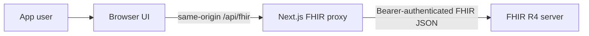

# Architecture

## Overview

Patient Management is a Next.js app for viewing and maintaining a small set of FHIR R4 resources: Patient (search, create, update), Observation vital signs, Condition, and MedicationRequest with referenced Medication. It also includes a FHIR Inspector, request log, learning panel and interactive console.

All clinical data stays on the upstream FHIR server. The app has no database and stores nothing locally. A server-side proxy keeps FHIR credentials off the client.

| Area | Technology |
| --- | --- |
| Framework | Next.js 16 App Router, React 19 client components |
| Language | TypeScript 7, strict mode |
| Charting | Recharts |
| Testing | Vitest |
| Runtime | Standalone Next.js server in a multi-stage Node.js Alpine Docker image |



## Routes

| Route | Responsibility |
| --- | --- |
| `/` | Paged, searchable Patient list; create/edit modal |
| `/patient/[id]` | One Patient with vitals, conditions and medications |
| `/console` | GET, POST and PUT requests through the proxy |
| `/api/fhir/[[...path]]` | Server-side proxy to the FHIR server |

The root layout ([app/layout.tsx](app/layout.tsx)) provides navigation and mounts the inspector controls and panel.

## Browser application

- [app/page.tsx](app/page.tsx): patient list, debounced search, infinite scroll, create/edit modal.
- [app/patient/[id]/page.tsx](app/patient/[id]/page.tsx): demographics plus the clinical sections.
- [app/console/page.tsx](app/console/page.tsx): request editing, parameter explanations, examples, paging, response inspection.
- [components/VitalsSection.tsx](components/VitalsSection.tsx), [ConditionsSection.tsx](components/ConditionsSection.tsx), [MedicationsSection.tsx](components/MedicationsSection.tsx): fetch their resources and render charts, tables and filters.
- [components/PatientFormModal.tsx](components/PatientFormModal.tsx): validates the form and builds Patient resources.

Server searches choose the set of resources; filtering and sorting for display happen in the browser.

### Domain helpers

These keep FHIR details out of components:

- [lib/fhir/format.ts](lib/fhir/format.ts): names, dates, codes, doses, routes, frequencies and statuses.
- [lib/fhir/patient.ts](lib/fhir/patient.ts): form validation and form ↔ Patient conversion.
- [lib/fhir/vitals.ts](lib/fhir/vitals.ts): LOINC vital-sign codes, panel components and chart rows. It converts each chart to one unit scale; readings with unsupported or mixed units are left out of the chart but still appear in the table.
- [lib/fhir/medications.ts](lib/fhir/medications.ts): finds Medication names in inline concepts, contained resources, `_include` entries or separate reads.
- [lib/fhir/types.ts](lib/fhir/types.ts): minimal R4 interfaces for the fields the app uses.

### State

There is no persistent browser store. Component state and hooks handle forms, search, filters, and loading and error states.

- [lib/useAsync.ts](lib/useAsync.ts) cancels stale requests, hides old data when dependencies change, and exposes a reload function.
- [lib/usePatientSearch.ts](lib/usePatientSearch.ts) handles debounced search, the `:contains` fallback, deduplicated infinite scroll and race protection.
- [lib/inspector/store.ts](lib/inspector/store.ts) is a module-level store read with `useSyncExternalStore`. Pages subscribe only to the enabled flag; the panel reads the full state.

## FHIR client

[lib/fhir/client.ts](lib/fhir/client.ts) is the boundary between the browser and the server. It:

- maps FHIR-relative paths and Bundle links to `/api/fhir/...` and never follows absolute upstream URLs
- sends and parses FHIR JSON, and turns HTTP and `OperationOutcome` failures into `FhirError`
- follows Bundle `next` links, capped at 50 pages
- records requests in the inspector log while inspector mode is on

Paging: the patient list loads 50 records per page as the user scrolls. Detail sections use `_count=200` and follow every `next` link.

## Proxy

[app/api/fhir/[[...path]]/route.ts](app/api/fhir/[[...path]]/route.ts) is the only code that talks to the FHIR server. Path policy and link rewriting live in [lib/server/proxy.ts](lib/server/proxy.ts), which imports `server-only`. The proxy:

1. Reads `FHIR_BASE_URL` and `FHIR_TOKEN` at request time. If either is missing or invalid, it returns a 500 `OperationOutcome`.
2. Validates the method and path (see below). Traversal-like segments, unknown resource types and overly deep paths are rejected.
3. Adds `Authorization`, `Accept`, `Prefer` and `If-Match` where they apply.
4. Forwards the request with a 30-second timeout.
5. Rejects responses that are not JSON.
6. Drops Bundle entries of types outside the allowlist (pulled in by `_include`, `_revinclude` or compartment searches) and refuses a single resource of such a type with 403.
7. Rewrites absolute Bundle links to same-origin proxy URLs, so internal hostnames are never exposed.
8. Returns upstream errors as they are, or generates an `OperationOutcome`: 502 for connection failures, 504 for timeouts.

| Method | Allowed |
| --- | --- |
| GET | Patient, Observation, Condition, MedicationRequest, Medication |
| POST | `Patient` |
| PUT | `Patient/{id}` |

An empty path is allowed only for a GET of a HAPI `_getpages` paging link, which blocks transaction and batch writes at the server base.

## Write flow

**Create:** `buildNewPatient()` → `POST Patient`. If the server returns no body, the form follows `Location` or reads `Patient/{id}`. If that also fails, it uses the submitted resource, so a successful write is never reported as an error.

**Update:** `buildUpdatedPatient()` → `PUT Patient/{id}`. Fields the form doesn't show (identifiers, addresses, extensions, profiles, tags, security labels) are preserved. Server-managed `meta` fields are removed. When the resource has `meta.versionId`, the browser sends `If-Match: W/"{version}"` so the server can detect lost updates.

## FHIR Inspector

The inspector adds teaching and diagnostic views on top of the normal pages. [components/inspector/Inspect.tsx](components/inspector/Inspect.tsx) wraps UI elements in an `InspectTarget`. A target names the element, explains its FHIR meaning, and lists the requests, resources and JSON paths to highlight. From a target the panel can:

- show the response as an expandable JSON tree with the relevant fields highlighted
- explain parameters, codes and code systems ([glossary.ts](lib/inspector/glossary.ts), [explain.ts](lib/inspector/explain.ts))
- replay requests that ran before inspector mode was switched on
- copy a curl command that uses an environment-variable placeholder instead of the token
- explain why a vitals chart is empty
- open the console with the request prefilled

Inspector mode is off after every page load and is never written to storage. Turning it off clears the captured data. The request log keeps at most 150 entries.

## Security model

The proxy is the security boundary. The browser never receives the token or the upstream URL, cannot reach arbitrary URLs, can read only allowlisted resource types (enforced on both the path and the response), and can write only Patient create and update requests. No FHIR data or log contents are written to browser storage.

The app has no user authentication or authorization of its own. The deployment environment must protect access to the UI and to the FHIR server.

## Errors

The client turns network failures, `OperationOutcome` resources and HTTP statuses into readable messages. Pages and sections show `ErrorBanner` or `Empty` states with a reload action. Abort errors from stale or unmounted components are ignored.

## Testing and deployment

Vitest (with an `@` alias and a `server-only` shim) tests the domain layer and the proxy directly: transformations, proxy path policy, form conversion, vital units, medication resolution, and inspector explanations, state and rendering. Proxy policy and FHIR transformations are covered by these unit tests, not by browser integration tests.

```bash
npm test && npm run typecheck && npm run build
```

The Dockerfile has three stages: `deps` (`npm ci`), `build` (standalone output) and `run` (Node.js Alpine, listening on `0.0.0.0:8080`). Credentials are supplied at runtime, for example with `--env-file .env`, and are never built into the image.

## Adding a FHIR resource or operation

1. Add minimal interfaces to [lib/fhir/types.ts](lib/fhir/types.ts) and domain helpers under [lib/fhir](lib/fhir).
2. Decide explicitly whether the proxy may read or write it, then update `ALLOWED_RESOURCES` and `buildUpstreamUrl()`.
3. Build the UI on [lib/fhir/client.ts](lib/fhir/client.ts), with an `InspectTarget` and glossary entries.
4. Add Vitest coverage for the proxy policy and transformations.

Never put credentials or absolute upstream URLs in browser code. Enforce write policy on the server even if the UI hides the controls.
